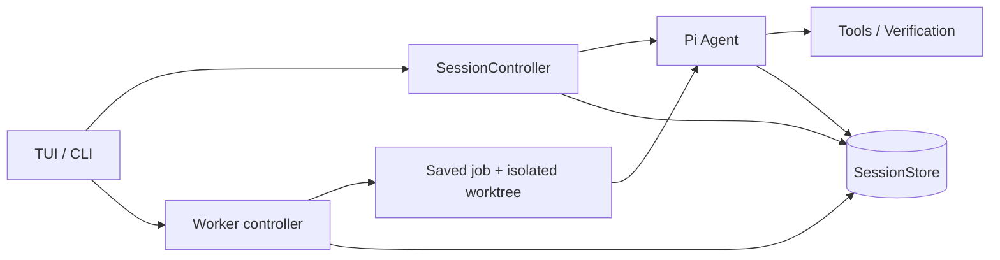

# 共通基盤・構成要素の詳細設計

更新日: 2026-10-25 / 状態: 実装前の設計案

[基本設計](design.md)と[Orchestrator設計](orchestrator.md)に対する共通契約を定める。本書は実装上の提案であり、ライブラリーの採用・実機確認は未実施。

## 1. 設定・起動・信頼境界

配置案は、非機密の個人設定を`~/.config/beethoven/`、repo設定を`<repo>/.beethoven/config.json`、実行状態を`~/.local/state/beethoven/`に分ける。XDGの指定がある場合は対応するrootを使い、backup/restoreではそのrootも記録する。認証は10章の保管先参照のみ設定に置く。

文章ルールとハーネスも共通/project-repo単位で管理する。project=repoの二層構成、形式・合成・適用snapshotは[ルール・ハーネス設計](rules-harness.md)を正本とする。現在のP1の数値/権限configに新機能を実装済みとはみなさない。

設定はbuiltin→個人→信頼済みrepo→CLIの順に解決し、各値の出所を表示できるようにする。ただしrepo設定で個人の権限・送信先・金額上限を拡大できず、実効許可は各制約の共通部分とする。秘密値の自動環境変数展開やrepoからの任意shell補間はしない。

未知のkey、schema不一致、循環参照、同名接続の曖昧な上書きを起動前に検出する。接続名とquotaGroupの定義は個人側を基本とし、repoは許可された接続IDだけを参照する。

repoの規約文書はモデルへの情報として出所付きで読み込むが、repo由来のbootstrap、検証コマンド、Extension、MCP接続等は実行可能設定として別扱いにする。許可した内容hashを記録し、実行可能設定の変更は再評価する。任意コードを評価するconfig形式はMVPで採用しない。

必須checkは共通とrepoの和集合で、下位が黙って解除しない。宣言設定の信頼とcheckの実行許可を分け、参照script等の版変更も再評価する。診断ではハーネスを実行しない。

起動順序は引数解析→設定schema検査→repo/state/権限確認→実効設定確定→DB整合性とmigration→所有権取得→復旧照合→接続選択→対話/バッチ開始。バックアップ・migration等の排他処理とは共通のmaintenance lockで調停する。

## 2. コンテキスト・Prompt・Session

Agentへ渡す情報を、製品の固定指示、repo規約、利用者の依頼、取得したコード/外部資料、検証Evidenceへ分けて記録する。ファイルとIssue等はpath/URL、取得版、hashとともに関連付ける。外部資料の文面を権限変更として扱わない。

repo規約は読み込む候補と順序を明示し、採用するPi版の探索仕様を確認してadapterで一元化する。独自loaderとPiの自動探索による二重投入を避ける。読込対象・省略対象を起動時に確認できるようにする。

大きいコードベースは検索→必要箇所の取得を基本にし、全ファイル・他Workerの会話を常時投入しない。入力予算を越える前に圧縮または必要資料の再選択を行う。コンテキスト内の秘密値を完全検出できるとは保証せず、送信先制約・除外pathを取得前に適用する。

圧縮時も原会話・出典参照を保存し、目的、制約、未完了作業、質問、検証対象をsummaryに残す。summaryは派生情報であり、権限・受入・費用の正本はDBとする。外部編集、モデル切替、復旧時には該当ファイルを再読込する。

Promptに版とhashを持たせる。システム指示、Task packet、結果schemaの変更をモデル評価の条件へ含め、モデル変更だけでない品質変動を追跡できるようにする。

## 3. ツール実行と権限

tool adapterは実行ID、入力schema、cwd、実行範囲、deadline、取消signal、結果と副作用の分類を共通に持つ。PolicyEvaluatorを通してからread/search/edit/shellを実行し、各toolの結果をPiの形式へ変換する。

編集はpathの正規化とsymlinkの解決で許可workspaceを確認し、読取時の内容hashと実行直前の内容を比較する。競合は上書きせず再読込する。binary、改行、実行権限、大容量ファイルは対応可否を明示する。

shellとテストは子プロセスグループで起動し、deadline、stdout/stderrの継続読取、出力量上限、完全ログ参照、取消と終了確認を備える。repo指定のコマンドはargvを基本とし、shell構文を必要とする場合は明示したshell scriptとして記録する。UI用の切詰めとEvidence保存の失敗を区別する。

`read-only`モードでは任意shellやコードを実行できるツールを許可しない。検索等を明示した読取adapterへ限定する。`workspace-write`でもhost上の任意shellにはworkspace外の権限が及び得るため、OS境界が未検証の状態で完全な書込制限を表示しない。

bootstrap/Verifierもrepo由来コードを実行するため、credentialとnetworkの扱いをWorkerと同じ基準で評価する。信頼したrepoのhost実行と、強制隔離済みの実行を表示で区別する。MCP/外部pluginは初期必須にせず、必要になった場合は同じPolicyと実行記録を通す。

## 4. 永続化と同時実行

SQLiteが制御状態の正本、Pi sessionが会話原本、artifactがコード・ログ・Evidenceの実体となる。参照ID/hashで結び付け、会話から状態を逆算して再構築しない。schemaの制約としてIDの一意性、外部参照、version、予約の重複防止を持つ。

StateStore APIはControllerの状態更新と、ローカル制御clientからのCommand投入を分ける。`stop/answer`等の別プロセスはcontrol requestの投入・読取だけを許し、Task状態や使用量を直接変更しない。WorkerはDBアクセスを持たない。別repoのControllerは同じstate DBを使うため、短いtransactionとbusy時の有限retryを必要とする。

SQLiteのWAL・foreign key・同期設定は採用driverで評価し、状態DBをnetwork filesystemへ置く運用はMVP対象外とする。process lock、version、ownerEpochを組み合わせ、SQLiteの書込直列化だけでプロセス所有権を保証したことにしない。

migrationはmaintenance lock下で全Controller停止を確認し、整合したバックアップを作ってから適用する。新しいschemaを古いCLIが開く場合は実行を拒否する。自動downgradeはしない。通常のローカルmigration backupとGitHubへの送信は別操作とする。

大きいartifactは一時path→hash検証→確定rename→DB参照登録とする。DBに未登録の残骸は起動診断で報告し、MVPでは自動削除しない。ディスク容量・書込エラー時はOrchestratorへ通知し、新しいモデル実行を止める。

## 5. UI・イベント・可観測性

対話UI、status、JSON、logsは正規化した同じ状態とイベントを使う。UIだけのTask状態やprogressを持たない。streamは表示用にまとめられるが、状態遷移、質問、エラー、費用確定を間引かない。

JSON出力にはschemaVersion、Session/Run/Task/Attempt、event seq、timestamp、stage、理由、使用量の精度を持たせる。利用者がイベントcursorを指定して再読込でき、接続切断後にsnapshotとの差分を取得できるようにする。M0のUI内配信にnetwork serverは不要。

logsはrun/task/attempt/tool/effect IDで追跡し、modelの隠れた推論全文の保存を製品要件にしない。providerが返した会話、tool入力/出力には機密が含まれ得るため、保存先権限と共有exportを分ける。既知の認証値をmaskするが、全機密の除去を保証したとは表示しない。

待ち理由は`dependency / quota / budget / resource / question / approval / environment / conflict / unknown_effect`等をcodeで表す。外部API失敗、モデル出力不正、テスト回帰、利用者中断、保存失敗を別分類にし、metricsで混ぜない。

## 6. GitHub・backup・外部サービスの境界

GitHub adapterはIssue/Project入力、push/PR公開、CI照会、backup repo送信を別のcapabilityとして提供する。認証scope、repo identity、送信内容、effect receiptを操作単位で記録し、開発repoの公開許可をbackup repoへの送信許可へ流用しない。

Issue/Project情報は取得時のsnapshotを使う。API pagination、rate limit、一部取得失敗を扱い、取得できなかったTaskを黙って除外した完全planを作らない。GitHubが使えなくても対話・手書き計画・ローカル検証を使える構成にする。

backupはmaintenance lockで全状態の停止を確認し、対象repoごとの作業状態も照合する。restored Sessionは履歴を維持し、旧PID・lease・未完了承認を実行権限として復活させない。archiveから必要なrepo/ファイルが復元できない場合、不足一覧を出してresumeを止める。保存方式と容量の制約は基本設計12章に従う。

## 7. インストール・更新・診断

開発は既存miseのNode環境で行い、`beethoven/`内の単一packageとlockfileを使う。TypeScriptをビルドしたCLIをpackageのbinから起動する構成を提案する。配布先・package名・署名等は別途確定し、現時点で公開済みとはしない。

Piは固定依存として利用し、SDKとRPCが同じ検証版を使うよう、ユーザーのPATH上の別Piへ無条件接続しない。RPCの起動entry pointは採用版で確認し、互換性検査を設ける。開発コードからグローバルPiの設定を自動変更しない。

`beethoven doctor`は、Node/Pi版、config出所、認証参照の有無、DB schema、repo/lock、必要コマンド、disk、backup復元に必要な条件を診断する。秘密値を表示せず、通常は有料prompt・package導入・自動修復・network送信を行わない。接続試験は明示optionと予算を必要とする。

更新は実行中Session/Runを停止してから行う。対応schema、Pi契約テスト、既存sessionの読込、backup復元を確認する。SQLite driver・UIライブラリー・暗号化toolの採用は評価Taskとして残し、名称だけで動作を保証しない。

## 8. 不足の監査と実装チェック

| ID | 今回補った不足 | 成果物と確認 |
| --- | --- | --- |
| BASE-01 | 設定の優先順位・信頼 | schema、実効設定の出所表示、repoからの権限拡大拒否 |
| BASE-02 | contextとPromptの所有 | loader/Prompt版、重複読込・外部編集・圧縮後の制約保持 |
| BASE-03 | toolの実行契約 | 内容競合・scope・取消・出力上限・read-only時のshell拒否 |
| BASE-04 | 制御clientとDB writerの整合 | control request API、複数Controller予約、migration排他、disk障害 |
| BASE-05 | UIと状態の一致 | event schema、cursor再読込、欠測・blocked・未検証の表示 |
| BASE-06 | 外部serviceとbackupの権限 | 部分取得、offline、effect再送、別領域restore |
| BASE-07 | 導入・更新・診断 | package/lockfile、Pi版整合、doctor、更新前後の復元確認 |

これらを実装Taskへ分解し、M0では対話に必要な範囲を、M1では並列・外部連携を追加する。未確定の技術選択は「未設計」ではなく評価対象・判定基準・時期を明示する。ただし、未検証のものを完成扱いにはしない。

### 8.1 実装前に評価・確定する技術選択

| 判断 | 候補・方針 | 確定時期と合格条件 |
| --- | --- | --- |
| Pi固定版とRPC entry point | 基本設計の評価版を起点に、SDK/RPCを同版へ固定 | 0a: tool、event、abort、usage、session再開の契約試験を通す |
| SQLite driver | Node組込みまたは外部driverを比較 | 0基盤: 対象Nodeでtransaction、migration、backup、並列予約、配布を確認 |
| 基本対話UI | Nodeの端末入力＋renderer、またはTUIライブラリー | 0b: 日本語入力・複数行・stream中入力・Ctrl-C・承認・非TTYの操作を確認。並列fleet画面は要求しない |
| 暗号化・backup保存先 | age等、専用private repo、小容量snapshot案 | 0c: 鍵の別保管、復号・別領域restore、容量・remote receiptを確認。利用者が保存先と鍵運用を決定 |
| hostと隔離環境 | M0は本人が管理するrepo。無人実行は別評価 | 無人運用前: ファイル・credential・network・プロセス回収の境界を実測し、未対応を表示 |
| GitHub認証と操作経路 | 既存CLI利用またはAPI adapterを比較 | 1b: 必要scope、pagination、rate limit、正しいSHAのCI、重複publish防止を確認 |

採用判断は本体の設計判断記録として版・根拠・検証結果を残す。機密値を含まない`config.example.json`、repo設定例、接続/ルーティング設定例を実装成果物に含める。未確定項目を処理するために、製品の対話操作やbackup要件を削除しない。

## 2026-10-25 現行実装の責務

| 部分 | 現在の責務 |
| --- | --- |
| SessionController | UIと独立したopening/idle/running/paused/closing/closed。二重run・実行中closeを拒否し、解放後の遅延eventを遮断 |
| openAgent/Pi SDK | 1会話のモデルloop、rules/scope/tool/verification、累計予算、context window、settlement |
| codingTools | 読取hash・外部変更・権限、検証結果、32 file単位の検索yield、同一失敗の反復停止 |
| Worker controller | 親子所有権・私有worktree、ready/start、待機保存/再開、checkpoint差分精算、停止とprocess回収 |
| SessionStore/JSON artifacts | SQLiteの実行正本とprovider receipt、競合検出して原子的に確定するjob/status/result |
| TUI/CLI | 表示・入力・操作のerror boundary。モデルの終了を画面の終了にしない。状態/log/contextの診断 |

全体をEffect/HTTP serverへ置き換えず、既存Pi・認証・SQLiteを維持した。現時点の問題を解く小さなcontrollerと既存moduleの拡張に留める。

質問待ちはjobへ保存してprocessを閉じ、明示回答で同じ子会話へ戻る。図のAgentは実行の共通基盤で、親子を同時に動かす意味ではない。
