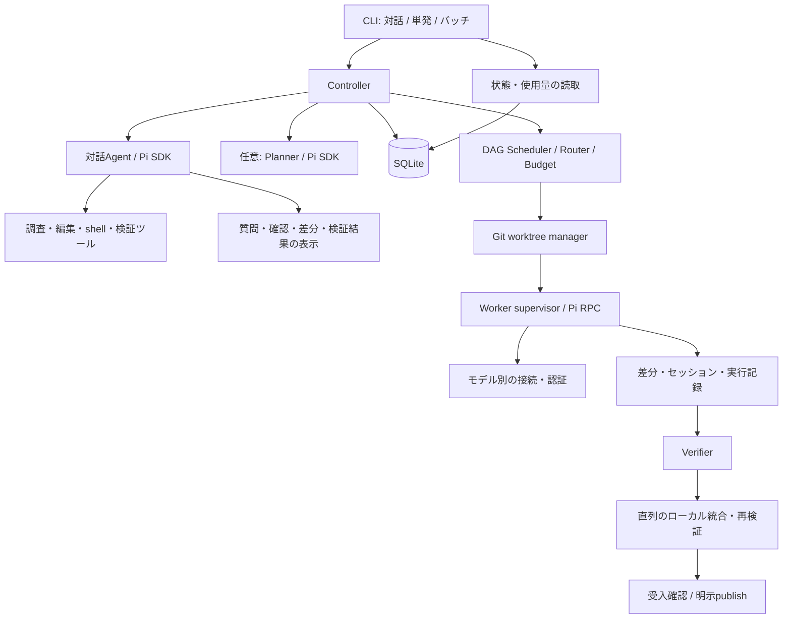

# Beethoven CLI 基本設計書

作成日: 2026-10-24 / 更新日: 2026-10-25 / 状態: Coding Agent要件を反映したレビュー版

詳細設計: [Orchestrator](orchestrator.md)、[共通基盤・構成要素](components.md)、[ルール・ハーネス](rules-harness.md)。基本設計が製品の要件と段階を定め、詳細設計が実装契約と障害時の処理を具体化する。

この文書は実装に向けた設計案であり、動作確認の報告ではない。独立したCoding Agentとして成立させること、モデルごとにAPIキー方式とサブスクリプション認証を選択すること、BeethovenをGitHubへバックアップすること、本人がコードを編集・保守できる最小限の構成で段階的に開発することはユーザー要件。それ以外の技術選択と運用の既定値は、以下の提案を起点に順次確定する。

## 1. 目的と到達点

**Beethovenを、Claude Codeのようにターミナルから自然言語で開発を進める、独立したCoding Agentとして成立させる。** 起動後の対話、コードベースの調査、ファイル編集、コマンド実行、検証、差分確認、継続指示、セッション再開までをBeethovenの操作で完結させる。Claude Codeの全機能・UI・互換性の再現を要件とするものではない。

その上で、開発タスクを複数モデルに割り当て、実装・検証にかかった費用、時間、失敗と受入結果を追跡する。長期目標は、実績に応じてモデルと並列数を改善し、受入済みタスクの完了効率を上げること。

最初に作るのは、**`beethoven`を起動して自然言語で1件の変更を依頼し、調査→編集→検証→結果確認→追加指示→中断・再開まで進められる縦断実装**とする。利用者にPiの起動や計画JSONの手作成を要求しない。その後にバックアップ・復元、DAGと並列実行を追加する。

品質を先に制約として定め、その条件を満たす割当の中で費用と所要時間を改善する。モデルの自己申告、テスト成功、CI成功、人間による受入、マージ、実環境での受入は別々に記録する。

### 1.1 既存のPi/Ponytail設計との関係

`../../docs/pi-ponytail-design.md`は、手動で利用するPi/Ponytail環境の設計である。Beethovenは独立したCLIとして本ディレクトリで開発し、既存の設定・セットアップを変更しない。Ponytailや他のマルチエージェント拡張を必須依存にはしない。

### 1.2 Coding Agentとして必須の利用体験

| 要件ID | 必須の動作 | 完了条件 |
| --- | --- | --- |
| CA-01 | repo内で`beethoven`を起動して会話する | 日本語の依頼に対し、JSONやIssueを作らず作業を開始できる |
| CA-02 | repo規約・コード・参照ファイルを調査する | 規約の読込元、作業cwd、調査結果を確認できる |
| CA-03 | ファイルの作成・編集とshellコマンドを実行する | ツールの対象・実行状況・失敗・差分を表示し、結果を次の判断へ戻せる |
| CA-04 | 計画、確認、実装、検証を往復する | 前提不足を質問し、失敗時に根拠を調べて修正できる。計画のみの依頼では編集しない |
| CA-05 | 途中停止・追加指示・会話継続・再開を扱う | 停止で子プロセスを残さず、履歴を見て同じ作業を継続できる |
| CA-06 | モデル・認証・予算・権限を設定する | 現在の接続と課金境界を表示し、無断で別課金へ移行しない |
| CA-07 | 差分・検証結果・未確認事項を提示する | Agentの応答終了と、検証・受入・commitを別々に判断できる |
| CA-08 | 会話と作業状態を保存しGitHubへバックアップする | 元端末の状態なしで履歴と未完了変更を復元できる |
| CA-09 | 非対話実行からも同じAgentを使う | prompt入力とJSON出力で自動実行でき、承認待ちを黙って通過しない |
| CA-10 | 開発全体とproject/repoのルール・ハーネスを管理する | 出所・適用版・必須check・許可が分かり、対話/Worker/再開で同じ条件を使う。project=repoとして二層で管理 |

並列管理だけが動いていても、CA-01〜10のM0対象範囲を満たさなければCoding AgentのMVP完成とはしない。CA-10のWorker適用はM1で追加する。会話・実装・検証のモデル判断にはPiを利用し、Scheduler等の実行制御をTypeScriptで管理する。

### 1.3 Beethoven本体をCodexで開発する際の実装原則

**Beethoven本体の開発にはCodexを使う。生成されたコードを本人が読んで理解し、直接修正・保守できるよう、必要最小限の構成と素直な実装を優先する。** Codexが実装・レビュー・リファクタリングを行う際は、この原則を基本設計・詳細設計・マイルストーン全体へ適用する。

- 現在の段階で必要な機能だけを実装する。将来の並列化・学習・配布を見越した汎用基盤や拡張機構を先に作らない。
- Piや標準機能を再利用し、独自コード、依存ライブラリー、設定項目、ファイル数を必要以上に増やさない。追加時は解決する具体的な問題を説明する。
- 素直な関数・データ構造と明確な命名を使う。重複が実際に問題になるまでは、汎用interface、継承、factory、plugin化等の抽象化を増やさない。
- 処理の入口から実際の処理までを少ない移動で追えるようにする。実装が1つしかない処理への不要なwrapper、多段の委譲、細かすぎるファイル分割、過度な型技巧を避ける。
- 抽象化を導入する場合は、現在のどの複雑さ・重複を減らすかを説明できることを条件とする。行数を減らすための詰め込みや、短いが読み解きにくい記法も避ける。
- 設計書の構成要素は責務の区別を示す。すべてを別package・別directory・独立serviceとして実装する必要はなく、必要になるまで同じmoduleに置ける。
- 変更を小さく区切り、入口、主な処理の流れ、設定箇所、検証方法を短く説明する。本人の変更を上書きせず、依頼外の整形・全面改修を混ぜない。
- コード内に日本語コメントを付け、各関数の役割と、権限・保存・エラー処理等の判断理由を説明する。説明を別文書だけに置かず、変更時に注意する制約を実装の近くへ残す。構文を言い換えるだけのコメントは増やさない。
- 認証・課金境界、既存作業の保護、停止・復旧、検証、バックアップ等の必須要件を維持した上で、実装方法を簡潔にする。必要な検証に絞り、現段階で使わない機能や実装をなぞるだけのテストを増やさない。

## 2. 採用を提案する方針

| 判断 | 初期方針 | 理由 |
| --- | --- | --- |
| 製品名・コマンド | `beethoven` | 配置先と一致させる。配布名の空きは別途確認 |
| 実装 | TypeScript / Node.js、単一パッケージ | Piとの接続を薄く保ち、小さく開始する |
| 標準の入口 | 引数なしの`beethoven`で対話Agent | 普段の開発を単体で完結させる |
| 対話Agent | Pi SDKによる会話・ツール実行ループ | 計画支援だけでなく調査・編集・検証まで担う |
| 制御 | 通常のTypeScriptによる状態機械・Scheduler | DAG、予算、停止、再試行を再現可能にする |
| LLMによるタスク分解 | Pi SDKを使う任意のPlanner | バッチ計画を構造化する。手書き計画でもバッチ実行可能 |
| 実装Worker | Pi RPCの独立子プロセス | Worker障害とControllerの状態を分離する |
| Agent間の連携 | タスク定義と固定した成果物の受け渡し | 会話履歴の共有を既定にしない |
| 永続化 | SQLite、実行状態は所有Controllerが更新 | 状態更新・所有権・予算予約を同一トランザクションで扱う。制御clientは要求投入のみ |
| Git作業場所 | 対話は現在の作業場所、バッチはattemptごとのworktree | 普段の編集と並列実行の整合性を両立する |
| 認証 | モデル接続ごとにAPI / subscriptionを選択 | ユーザー確認済み。課金境界を明示する |
| CLI表示 | 基本対話UI＋Commander＋JSON | 会話入力と実行表示はM0必須。高度な並列TUIは後段 |
| モデル選択 | 明示指定＋決定的なルール | 実績がない段階で優劣を推定しない |
| GitHub | 最初は読取。外部更新は後段 | 実行評価と公開・受入を分離する |

Nodeは既存`mise/config.toml`の24系を開発候補とする。Piおよび依存パッケージは評価後に具体版を固定する。SQLiteドライバーは`node:sqlite`等を評価し、トランザクション・バックアップ・配布の要件で決定する。

## 3. Pi仕様の確認と未検証事項

2026-10-24に公式資料とnpm公開メタデータを確認した。現行ドキュメントは更新されるため、実装時には採用版同梱の型・資料との契約テストを必要とする。

| 項目 | 確認内容・設計への反映 |
| --- | --- |
| SDK | `@earendil-works/pi-coding-agent`をNode.js内に組み込める。対話AgentとPlannerのモデル・ツール・セッション設定を明示する [S1] |
| 配布版 | npm `latest`は確認時点で`1.4.0`、Node要件は`>=22.19.0`。採用・実機検証は未実施 [S7] |
| RPC | 子プロセスのJSONL制御。現行資料はTypeScript向け`RpcClient`を提供。自作通信層より先に適合性を評価する [S2] |
| 終了通知 | `prompt`応答は受付結果。`agent_settled`まで観測し、エラー・abort・出力を調べてから検証へ進む [S2] |
| 使用量 | ストリームの累積usageを逐次加算しない。確定メッセージとセッション統計を照合する [S3, S4] |
| Provider | 互換エンドポイントと独自ストリーム実装の拡張経路がある。モデル名だけで接続可能とみなさない [S5] |
| Extensions | ツールとイベントを拡張できる。OS権限の隔離は別途扱う [S6, S8] |

初期の具体的なモデル候補、役割別の割当、採用判定は10.1〜10.3章、Workerの運用は9.4〜9.7章に定める。ブランド単位の能力・安さ・subscription利用可否を保証しない。

## 4. スコープと段階

| 機能 | M0: 単体Coding Agent MVP | M1: 並列開発MVP | M2以降 |
| --- | --- | --- | --- |
| 入力 | 自然言語の対話・単発prompt、任意の計画JSON | GitHub Issue / Projectのスナップショット | 再計画・同期 |
| 対話 | 会話入力、ツール表示、確認、追加指示、再開 | バッチ開始とWorker状況の参照 | 高度な対話操作 |
| モデル | 1接続を通し、次に別接続で同条件比較 | 設定済み複数モデル・ルール割当 | 実績に基づく選択 |
| 実行 | SDKの単体Agent＋RPC評価、cwd編集、停止・復旧 | 最大4 Worker、worktree、DAG、予算予約 | 動的並列数 |
| 永続化 | Run / Task / Attempt / Evidence / Usage | 所有権・統合履歴 | 分析・運用拡張 |
| 品質 | 明示したローカル検証＋受入記録 | 統合検証、公開済みSHAのCI照合 | リスク別検証 |
| 表示 | 基本対話UI、status / logs / JSON | 複数Workerの一覧 | Ink等の高度な並列TUI |
| バックアップ | 停止中の手動snapshot・GitHub保存・復元 | 操作の改善 | 明示設定による定期実行 |
| GitHub更新 | 対象外 | 明示したpublish操作でpush・Draft PR | 明示ポリシー下の統合 |
| 最適化 | データ収集 | 基本metrics・再現可能なbenchmark | Bandit、競争実行 |

初期対象はローカルmacOS、単一ユーザー、1 Runにつき1リポジトリとする。Windows、分散Worker、複数リポジトリ間DAG、常駐サービス、自動merge・deploy・Issue closeはMVP外。複数リポジトリのIssueを含むProjectは対象repoを必須指定し、他repoの依存は外部前提として表示する。

## 5. 全体構成と責務



- **Orchestrator / Controller**: Orchestratorは実行制御層、Controllerはその所有プロセス。Session/Runごとに唯一の所有者が割当・状態更新・終了を担う。制御ループと契約は[詳細設計](orchestrator.md)に定める。
- **Interactive Agent**: 利用者との会話を維持し、調査・計画・編集・コマンド実行・検証を進める。Pi SDKのAgent loopを使い、独自に推論ループを二重実装しない。
- **Session/UI**: 入力、stream表示、tool状況、質問・承認、割込み、接続・使用量の表示を扱う。バッチWorkerの全会話を対話Agentへ自動転送しない。
- **Planner**: Issueを構造化した計画案へ変換する。実行権限を持たず、スキーマとDAG検証を必ず通す。
- **Scheduler / Router**: 依存、資源、モデル制限、予算を満たすタスクだけを開始する。
- **Worker supervisor**: RPCイベント、PIDと起動識別子、deadline、セッション、stdout/stderrを管理する。
- **Verifier**: Agentの申告とは独立して検証結果を記録する。対話は作業状態の内容hash、バッチは固定SHAを対象にする。
- **Integrator**: 候補commitを専用統合worktreeへ直列に適用し、依存先へ渡すbase SHAを確定する。
- **GitHub adapter**: 入力スナップショットと、明示された公開操作・CI読取を扱う。

SDKやRPCのPi内部型はadapter境界から先へ持ち込まない。ただし架空の汎用Agent基盤を先に作らず、必要な操作だけを定義する。

```ts
interface WorkerHandle {
  attemptId: string;
  events: AsyncIterable<WorkerEvent>;
  prompt(input: TaskInput): Promise<void>; // 受付。タスク完了ではない
  abort(): Promise<void>;
  snapshot(): Promise<RuntimeSnapshot>;
  close(): Promise<void>;
}
```

プロセス起動、終了待機、強制終了はSupervisorが担う。復旧時は既存pipeへの再接続を前提にせず、新プロセスで保存済みセッションを開く。

### 5.1 対話・単発・バッチの関係

| モード | 作業の開始 | 作業場所・終了 |
| --- | --- | --- |
| 対話（既定） | 自然言語で依頼し、Agentが必要な調査・編集・検証を進める | 現在のcwd。応答終了後も追加指示を受け付ける |
| 単発 | `--print`でpromptを渡す | 同じAgent・ツール・権限判定を使い、応答終了後にexit |
| バッチ | `plan`で固定したTask契約を`run`へ渡す | 隔離worktreeとRPC Worker。DAG・統合・受入管理を使う |

モード間でモデル接続、ツールの権限判定、使用量、Evidence、バックアップ形式を共通化する。対話から並列委譲する場合も、Task契約と予算を確定してControllerへ渡す。Agent自身にSchedulerの状態を書き換えさせない。

### 5.2 対話Agentの操作と権限

起動時にcwd、repo/branch、既存差分、規約の読込元、接続・認証方式、許可範囲を表示する。読取・検索、編集、shellのツールを提供し、ツール実行前後と検証結果を確認できるようにする。コンテキストの圧縮・ファイル参照・モデル切替もsession履歴へ記録し、切替時に課金方式を再表示する。

基本操作案は`/help`、`/model`、`/permissions`、`/diff`、`/sessions`、`/exit`。Ctrl-Cは実行中のturnとその子プロセスを停止し、会話自体は継続できる。入力編集中・実行中・確認待ちをUI上で区別する。実行中の追加指示はキューへ保存し、M0では停止後またはturnの安全な境界から適用する。

権限は`read-only / workspace-write`を基本とし、workspace外への書込、破壊的コマンド、認証・本番操作、push等の外部更新には対象と理由を表示する。既に許可された範囲内の編集・検証を毎回確認しない。shellの任意コード実行を文字列検査だけで完全に制限できるとはみなさず、強制隔離が必要な利用には10章の実行環境を使う。

質問・承認の要求と回答を永続化する。非対話では必要な回答がなければ`blocked`を出力し、許可を推測して続けない。計画のみ、調査のみ等の依頼範囲をsessionの実行制約として記録し、編集ツールの許可にも反映する。

### 5.3 共通とproject/repoのルール・ハーネス

projectとrepoは同じ管理単位とし、開発全体の共通ルールとrepo固有の規約・checkを合成する。文章指示、実行ポリシー、実行するハーネスを区別し、権限の共通部分と必須checkの和集合を守る。適用snapshotを対話・Worker・再開・backupへ引き継ぎ、定義や実行コードの変更時には許可・証拠を再評価する。仕様と受入条件RH-01〜08は[詳細設計](rules-harness.md)に定める。P1の既存config実装にはまだこの機能を含まない。

## 6. 入力契約と計画の確定

対話では自然言語を入口とし、会話の目的、許可範囲、質問・回答、作業対象、検証結果をSessionへ保存する。通常の調査や小さな編集に、以下の全項目を利用者が手入力する必要はない。不足する重要な前提は質問し、Agentが補った仮定を表示する。

以下はバッチまたは並列委譲するTaskの入力契約である。Issue本文をそのまま実行指示にせず構造化する。外部テキストは仕様の材料として扱い、認証・公開方針の変更指示として解釈しない。

| Taskの項目 | 内容 |
| --- | --- |
| identity | task ID、repo identity、Issue URL/番号、取得時刻・更新時刻、本文hash |
| goal / scope | 目的、対象範囲、対象外、参考資料 |
| acceptance | ID付き受入基準、検証方法、機械判定 / 人間判定の区別 |
| dependencies | 上流Task ID、必要な成果物、外部前提 |
| execution | 変更予定path、排他resource、検証コマンドID、timeout |
| routing | 接続候補、明示指定、選択ルール、fallback候補 |
| limits | attempt上限、時間・token・金額上限 |

未定義依存、循環、重複ID、不足する受入基準、未知の検証コマンド、使用不能なモデル、予算不足は実行前に検出する。GitHubの更新時刻は取り込み時に保存し、既存Runへ黙って再同期しない。

`plan`は計画案を出力するだけ。利用者が編集・確認したファイルを`run --plan <file>`へ渡すことで、その計画の実行を指示する。Run作成後はplan、設定、基準commitをhash付きで固定し、変更時は新しい計画版を作る。

## 7. 状態モデルと完了の定義

対話Sessionは`idle / responding / waiting_input / waiting_approval / stopping / interrupted / closed`を持つ。1回の応答終了はSessionの終了でも利用者の受入でもない。TurnごとのRuntime実行・ツール・使用量・Evidenceを関連付け、会話を継続できるようにする。再起動時はSessionとPi sessionの対応を照合し、実行中だったTurnを完了済みにしない。

以下はバッチの状態モデル。Task、Attempt、Runの状態を混同しない。Workerの1回の起動をAttemptとし、同じTaskの復旧や再試行は履歴をつないだ新Attemptにする。

```text
Task:
  pending -> ready -> running -> verifying -> [reviewing] -> integrating -> awaiting_acceptance -> accepted
                      |             |             |
                      +----失敗-----+-------------+-> retry_wait -> ready
                      +----停止/消失----------------> interrupted
  前提不足・競合・判定不能 -> blocked
  再試行枠終了 -> failed / 利用者の取消 -> cancelled

Attempt:
  prepared -> starting -> running -> stopping -> interrupted
                         running -> settled -> verifying -> passed / failed
                         起動失敗・異常終了 -> failed / lost
```

`settled`はRuntimeの停止点であり、Task成功ではない。`passed`はそのAttemptの検証を通過した候補であり、受入済みではない。`blocked`は理由と解除条件を記録し、解除時に前提を再評価する。

Runは`planned / running / stopping / blocked / interrupted / awaiting_acceptance / completed / failed / cancelled`。全Taskが`accepted`になったときだけ`completed`。進行可能なTaskがなく前提・承認が不足していればblocked。失敗の確定後は独立Taskのみ継続し、全稼働終了後に内訳付きfailedとする。reviewingは必要なTaskだけの任意段階とし、Run集計の優先順位はOrchestrator設計4.1章に従う。マージ・本番受入はTaskの受入状態と別の記録とする。

受入基準ごとに`pass / fail / unknown / not_applicable`と証拠を持つ。人間確認の基準が残れば`awaiting_acceptance`。MVPでは`accept`で利用者が固定SHAと基準ごとの結果を確認する。CIだけで自動acceptしない。

## 8. DAG・worktree・成果物の引き渡し

### 8.1 Scheduler

依存Taskの候補が統合・検証済みで、必要な人間判定も充足したものをreadyにする。コード提供だけを要する依存は統合検証済みSHAで解放できるが、製品の受入を前提とする依存は`accepted`を待つ。この依存種別をplanで明示する。

開始順は明示priority、次に安定したtask ID順。並列数はRun全体、provider別、repo resource別で制限する。初期値は1、M1で利用者が最大4まで指定可能にする。

予定変更pathの重複と、DB migration・lockfile・同一ポート等のresource宣言で並列を抑制する。予測できない競合は残るため、実際の差分検査と直列統合を必須とする。

### 8.2 Gitの境界

対話モードは利用者のcwdで編集し、開始前のtracked/untracked差分を記録する。dirty状態でも起動できるが、既存差分をAgentの成果として報告しない。同一箇所の競合は内容を確認し、判断が必要なら利用者へ返す。commitは依頼された場合に行い、通常の編集・検証の必須条件にはしない。別Controllerとの同時書込はrepoの実行lockで拒否する。同じControllerで並列委譲する場合も親の直接編集を停止し、子の成果をcwdへ黙って適用しない。

以下の手順はバッチモードに適用する。

1. 開始時にrepo、HEAD SHA、既存worktree、dirty状態を確認する。入力repoに未コミット変更がある場合、MVPのバッチ開始を拒否する。既存変更の自動stashや破棄はしない。
2. Run専用統合ブランチを基準SHAから作る。各Attemptは確定した統合SHAから専用worktreeを作る。Workerのcwdをそこへ固定する。
3. Worker停止後に、変更ファイル、untracked、binary、submodule差分と宣言scopeを検査する。scope外は自動受入しない。
4. Controllerが対象を明示して候補commitを作り、VerifierがそのSHAを検証する。検証中のsource tree変化は不合格とする。
5. 統合Managerが順に候補を専用統合worktreeへ適用し、統合SHAで再検証する。競合・回帰はblockedにし、元成果物を保存する。
6. 依存Taskは、その統合SHAから起動する。文章による成果報告だけではコード依存を満たさない。

同じbaseから並列実行したTask同士も、統合後のSHAで検証し直す。新しい統合SHAで既存の証拠が有効かを再評価し、失効した受入記録は再確認する。自動競合解消は初期には実装しない。

worktreeはファイル作業の分離であり、sandboxではない。Git metadata、ホストのファイル、ネットワーク、実行プロセスには別の制約が必要 [S8]。

## 9. 実行所有権・停止・復旧

### 9.1 所有権

対話起動・単発実行・`run`はいずれもフォアグラウンドのControllerとして動く。対話SDK sessionもControllerが所有し、モデルによるDB直接更新を許可しない。端末を閉じても処理が続くdaemonは初期対象外。`status`はDBを読み、`stop/answer`はStateStoreの制御client用APIで要求を記録する。WorkerはDBへ書かない。別repoのControllerは同じstate DBでquotaGroupを共有するが、他のRun/Sessionの状態を直接更新しない。

repoごとの実行lockと、Runのowner token・heartbeat・leaseを取得する。開始予約とAttempt作成はトランザクション化する。lease切れだけでは二重起動せず、旧ControllerとWorkerの終了、PID再利用、worktreeの所有者を照合する。生存確認が曖昧ならblockedとする。

### 9.2 停止

`stop`またはCtrl-Cで新規dispatchを止め、RPC abortを送り、設定した猶予内に静止・終了を待つ。応答しなければ所有するプロセスグループへTERM、次にKILLを送り、子の検証・shellプロセスも確認する。OSごとの挙動はM0で実測する。

対話AgentではSDK側のabortとツール実行の停止を同じ制御要求へ結び付ける。Ctrl-Cでは進行中Turnを停止して入力へ戻り、`stop`や終了操作では保存してSessionを閉じる。SDKが自プロセス内で動くため、応答停止後も残るshell等の子プロセスを別途回収できることを検証する。

セッション、差分、最後のusage、実行コマンドと終了状態を保存して`interrupted`にする。進行中のモデル呼び出し・shell操作を命令位置から再開できるとは保証しない。

### 9.3 復旧

`resume <run-id>`はplan/config hash、worktree、HEAD、session、旧プロセス、予算残量を照合し、復旧報告を保存する。起動途中・検証途中・統合途中のどこで落ちたかに応じて、実体と照合して状態を確定する。

`beethoven --resume <session-id>`は対話を復元する。前回からcwdのHEADやファイルが変わっていれば差異を提示し、必要箇所を再読込して継続する。古い会話の認識で新しい変更を上書きしない。Turnの使用量とセッション累計を区別し、既支出を保持する。

同一モデル・設定・作業内容が一致する場合だけセッション継続を候補とする。新Attemptに`resume_of`を記録し、前回の変更と未完了操作を調べてから指示する。非冪等な外部操作の結果が不明なら再送せずblockedにする。

モデル変更時は新セッションとし、入力契約、固定成果物、検証失敗だけを渡す。失敗Attemptのworktreeは保持する。未コミット差分や不明な副作用を黙って引き継がない。

### 9.4 Workerの役割と起動単位

Workerは**1つの役割・1つのTask・1つのAttemptにつき1プロセス**とする。RPCプロセスを別Taskへ使い回さず、初期のWorker poolは同時実行枠として実装する。会話コンテキスト、cwd、認証、費用が別Taskへ漏れることを避ける。対話AgentはSDK sessionとして独立し、実装Workerの上に別のLLM管理Agentを常駐させない。

| 役割 | いつ使うか | 入力と権限 | 出力・終了条件 |
| --- | --- | --- | --- |
| Explorer | 分割前の調査が必要な場合だけ | 固定したrepo状態、調査目的。ファイル読取・検索を基本とする | 根拠path、依存、変更候補、不明点。コード編集なし |
| Implementer | バッチTaskごとに1つ | Task契約、base SHA、scope、規約、検証コマンド、予算。専用worktreeで編集・検証 | 変更差分、検証結果、残課題、結果manifest |
| Reviewer | planで指定した高リスク変更、または利用者の要求時 | 固定候補SHA、差分、受入基準、Evidence。対象コードへの書込なし | 根拠付きfinding、severity、unknown。合格の自己申告だけでは受入不可 |
| Verifier | 全実装候補・統合候補 | 設定済み検証コマンドと固定したコード状態 | exit codeとEvidence。LLM不要の通常プロセス |
| Integrator | Verifierを通過した候補ごとに直列 | 候補commit、現在の統合SHA | 統合SHAと再検証結果。LLM不要、競合はblocked |

Explorer/Reviewerは任意の別Taskとして履歴に残し、起動時に同じ並列枠と予算を消費する。Reviewerの修正指示は直接編集させず、Controllerが有限の修正Attemptへ変換する。M1では自動の委譲・再委譲をWorkerへ許可しない。

### 9.5 1 Taskの標準運用

1. **準備**: Schedulerが依存・scope・resource・認証・予算を確認し、Task所有権と枠を予約する。接続の疎通評価は先に済ませ、各Taskで有料の疎通promptを繰り返さない。
2. **環境構築**: base SHAからworktreeを作り、repo定義のbootstrapを実行する。lockfileを使い、共有可能なdownload cacheとTask専用の依存・出力先を分ける。bootstrap失敗は環境失敗として分類する。
3. **起動**: 固定したPi版、接続、tools、session保存先、環境変数、timeoutを指定してRPCを起動する。event購読を先に設定し、起動manifestを永続化してからpromptを送る。
4. **実装**: Workerは対象を調べ、編集し、許可された診断・テストを実行する。Controllerは状態・使用量・deadlineを監視し、Workerの提案があってもscope・認証・上限を無断変更しない。
5. **質問待ち**: 前提・権限が不足したら構造化した質問を保存し、Taskをblockedにする。Workerを終了し、差分とsessionを保持して枠を返す。回答後はTask契約を改版し、新Attemptで再開する。初期実装では質問待ちに無期限でプロセスを保持しない。
6. **成果の確定**: `agent_settled`後にモデルエラー・abort・未完了操作を確認する。Workerを終了して書込を止め、Controllerが差分とscopeを検査し候補commitを作る。
7. **独立検証・レビュー**: Verifierが候補SHAを検証する。必要な場合だけReviewerを起動する。修正が必要なら失敗根拠を保存し、retry policyに従う。
8. **統合・受入**: Integratorが直列適用し、統合状態を再検証して依存先へ渡す。人間判定が必要な基準はawaiting_acceptanceとし、終了時に費用・時間・差分・証拠・残課題を報告する。

bootstrap、Verifier、Reviewerを含む各段階にも開始・終了・失敗記録を残す。モデルが終了しても、検証・統合中はTaskの実行が継続していることを表示する。

### 9.6 引き継ぎと結果契約

Workerへ渡すTask packetは、goal/scope/対象外、受入基準ID、repo規約、base SHA、依存成果物のhash/path、指定検証コマンド、接続と上限、質問・結果の返却形式で構成する。認証情報や他Workerの全文会話を含めない。

結果manifestは`taskId / attemptId / outcome / summary / changedPaths / validationClaims / evidenceRefs / openQuestions / failureClass`を必須とする。`outcome`は`candidate / blocked / failed / interrupted`。候補SHA・使用量・実際の差分・検証結果はController側で照合・確定し、Workerに書かせたmanifestだけを正本にしない。

結果形式が不正なら失敗として記録し、保存した差分とRuntime記録を失わない。会話の最後の自然文だけから成功を推定しない。中間の情報共有はController経由の固定成果物に限る。質問・停止理由・引き継ぎ資料は、後から利用者が`status/logs`で確認できるようにする。

### 9.7 初期の運用パラメーター案

以下はproviderの仕様値ではなく、実測で調整するBeethovenの初期案。金額・token上限は利用者が設定し、無制限を既定にしない。

| パラメーター | 初期案 | 挙動 |
| --- | --- | --- |
| Worker並列 | 既定1、M1上限4 | Explorer/Implementer/Reviewerを合算。対話から委譲する場合も対話のモデル実行を含め最大4枠 |
| 接続別並列 | 既定1 | 同じ契約枠を使う接続は`quotaGroup`で合算。API keyを変えただけで制限を迂回しない |
| ローカル検証並列 | 既定1 | LLM枠とは別。CPU、メモリ、port/resourceの上限を優先 |
| RPC起動期限 | 30秒 | 起動・初期状態確認が完了しなければ起動失敗 |
| Attempt wall time | 30分 | bootstrapからWorker・検証までを含む。上限で停止し、延長には設定変更を記録 |
| モデルturn上限 | 50 / Attempt | Pi内部retryを含む呼出回数も別計測。上限で停止 |
| 無出力検知 | 180秒で警告・状態照会 | 推論中・長時間ツールを失敗と即断しない。照会期限30秒、回収不能なら停止・復旧判定 |
| 単一検証コマンド期限 | 10分 | repoの明示設定で変更可能。Attemptの残時間も上限 |
| abort猶予 / TERM猶予 | 各10秒 | 期限後に次段階へ移り、プロセス消失を確認する |
| Controller heartbeat / lease | 5秒 / 30秒 | lease失効だけで新Workerを開始しない。9.1章の生存照合を必須とする |
| 実装試行上限 | 2 / Task | 最初の実装と、失敗後の修正または別モデルへの引き継ぎ。質問への回答・停止後の継続は失敗retry枠と別計数 |
| 全起動上限 | 10 / Task | 質問・停止後の継続を含む全Attemptの上限。Taskの時間・金額・token残量も引き継ぎ、無限再開を防ぐ |
| 一時通信retry | 1モデル呼出あたり最大2回 | Pi内部retryを含む共通上限。指数backoff＋jitter、provider指定のRetry-Afterを優先。Attempt期限・予算内のみ |

同じTaskでretry、モデル昇格、Reviewerからの差戻しが重なっても失敗retry上限を別々に加算しない。質問回答による継続でも新Attemptの履歴を残し、全起動上限を超えたらblockedとして枠追加を利用者へ求める。rate limitが続く場合は接続/契約枠全体のdispatchを抑制する。実行中の全Task、対話Turn、検証プロセスの予約を一覧化し、停止対象をIDで指定できるようにする。

## 10. モデル接続・認証・権限

モデル能力と認証契約を分け、`connectionId`で接続を識別する。**利用者が初回設定で複数の接続・認証方式・既定modelを選ぶ。** 本人の利用予定はCodex/Claude/Kimiのsubscriptionで、製品の固定設定にはしない。[初回設定設計](setup.md)に操作・保存・試験を定める。

```json
{
  "id": "coding-api",
  "provider": "<Piで検証したprovider-id>",
  "model": "<検証したmodel-id>",
  "auth": { "method": "api_key", "credentialRef": "env:BEETHOVEN_MODEL_KEY" },
  "billing": { "kind": "metered", "currency": "USD" },
  "maxConcurrency": 1
}
```

subscription接続は`billing.kind: subscription`とし、`auth.method`には実際のOAuth/API key等の方式を保存する。`credentialRef`はPiの対応する認証保管先への参照。API keyと従量課金を同一視しない。これはBeethovenの設定案であり、Piへそのまま渡す形式ではない。Piのどの認証経路へ対応するかはM0で確定する。

- モデルと認証方式の組合せを起動前に確認し、非対応は停止する。subscription失敗時にAPIキーへ自動切替しない。
- 別認証・別課金へのfallbackは、planで明示した接続候補と予算の範囲だけで許可する。
- 認証情報本体をplan、SQLite、ログ、Gitへ保存しない。必要な環境変数だけをWorkerへ渡す。
- WorkerにGitHub書込credentialを既定で渡さない。公開処理はController側の専用操作に分ける。
- 初期設定は専用のPi agent directoryと明示したresource一覧を利用し、グローバル・project拡張の無条件自動読込を避ける。実際の読込経路とrepo規約の取り込みは評価で確認する。
- ホスト実行ではpromptやExtensionだけで外部操作を完全には禁止できない。任意repoを無人実行する運用は、ファイル・credential・networkを制限する隔離環境を検証してから対象にする。

### 10.1 初期モデル構成案

2026-10-25にOpenAI公式モデル資料、Anthropic公式モデル一覧、DeepSeek公式資料、Pi公開catalog等を確認した [S12〜S18]。以下は**具体的な採用候補と評価順序の提案**であり、利用者の契約、Pi固定版での接続、実Taskの品質・費用は未検証。catalog掲載、疎通成功、運用採用の3段階を区別する。

| 接続名案 | モデル・provider候補 | 想定用途 | 認証・採用段階 |
| --- | --- | --- | --- |
| `primary-sol` | GPT-6.1 Sol / `gpt-6.1-sol`。Piの`openai`または`openai-codex`を別接続として評価 | 対話と通常実装の基準モデル、Planner | M0で最初に評価する提案。API / 対応するsubscription経路の利用可否を別々に確認 |
| `alternative-sonnet` | Claude Sonnet 5.5 / `claude-sonnet-5-5`、`anthropic`接続候補 | 基準モデルとの比較、通常実装、異系統レビュー | M0の比較候補。初回設定で利用者が選んだAPI/subscription経路を別接続として評価 |
| `economy-deepseek` | DeepSeek V4.1 Flash / `deepseek-flash`、`deepseek` | 範囲が狭く、検証方法が明確な実装・調査 | M1の費用重視候補。API。基準モデルと同条件の評価に合格後だけ自動割当 |
| `escalation-astra` | GPT-6 Astra / `gpt-6-astra`、OpenAI接続候補 | 基準モデルで解決しない調査・設計・修正 | 明示設定した昇格先。API / subscriptionは別接続・別予算 |
| `escalation-opus` | Claude Opus 5.5 / `claude-opus-5-5`、`anthropic`接続候補 | 別系統での難しい調査・レビュー | Astraとの比較候補。初期から両方を自動呼出ししない |
| `candidate-qwen` | Qwen3-Coder-Plus / `qwen3-coder-plus`、Model Studio互換接続候補 | coding向け比較試験 | 後続評価。公式Qwen資料で名称確認。endpoint・Pi設定・地域・料金体系を確定してから有効化 |
| `candidate-kimi` | Kimi K2.7 Code / `kimi-k2.7-code`、Pi catalogの`moonshotai` | coding向け比較試験 | 後続評価。Pi掲載を確認。契約先の公式model一覧、認証・料金は評価前に再確認 |
| `subscription-kimi` | Kimi Code / `kimi-coding`。modelは接続catalogから利用者が選択 | 本人のsubscription評価候補 | Pi 1.4.0のOAuth定義を静的確認。通常のMoonshot APIとは分け、実認証・model応答は未確認 |

OpenAI公式資料はcodingの候補としてGPT-6系を案内し、Anthropic公式資料はSonnet/Opus等のモデルIDとtool対応を示している [S12〜S14]。ここでの役割分担はBeethovenの仮説であり、自分のrepoでの優劣を示す実測ではない。Fable等の追加モデルは初期評価対象を増やさず、必要になった時点で比較する。

最初から全候補の契約・実装を要求しない。表の基準モデルは評価仮説であり、製品の固定既定値にはしない。M0では初回設定で選んだ基準接続を1つ通し、別モデルまたは別認証の接続を追加して、特定接続に依存していないことを確認する。利用可能な基準接続がなければ、利用者が選んだ代替を明示設定して評価し、黙って別課金へ切り替えない。

model IDに版がある場合は固定版を優先し、aliasしかない場合はaliasと観測日・応答のmodel情報を記録する。context長、最大出力、tool/streaming対応、reasoning設定、価格表と通貨は**実際のproviderと接続ごと**に保存する。Pi catalogの価格を請求額の正本とせず、実行前の公式料金と照合する。常に最新aliasへ自動更新しない。

### 10.2 役割別ルーティング案

| 役割・条件 | 初期割当 | 切替条件 |
| --- | --- | --- |
| 対話・Planner | 利用者が設定した基準接続。推奨評価開始は`primary-sol` | 利用者の指定、または事前設定したpolicyのみ |
| Explorer | 基準接続。費用重視接続は評価合格後 | read/search、scopeが明確、機密データの送信先制約に適合 |
| Implementer・通常 | 基準接続 | 合格済みのTask種別だけ費用重視接続へ割当 |
| Implementer・高リスク | 基準接続または事前指定の昇格接続 | 認証/権限、課金、データmigration、公開interface等の変更は低費用モデルへ自動降格しない |
| Reviewer | 可能なら実装者と異なる評価済みモデル | Reviewer指定Taskのみ。別系統が使えなければ同一モデルであることを記録し、独立性を過大評価しない |
| Verifier / Integrator | モデルなし | 通常のコードで実行・判定 |

通常はImplementerが調査から修正・自己検証まで一貫して行う。全TaskにExplorer/Reviewerを追加せず、Taskの不明点・risk・利用者指定で起動する。

昇格は有限の再試行枠内で、検証失敗に実装修正の余地がある場合に限る。環境・認証・予算・受入基準不足を高性能モデルで解消したことにしない。別モデルへ渡す際は9.3/9.6章の引き継ぎ契約を使い、元Attemptの費用を保持する。

### 10.3 採用判定と設定成果物

接続ごとに、①認証・契約確認、②Pi SDK/RPCのtool/streaming/usage、③日本語の指示とrepo規約、④read/edit/shellと検証、⑤abortとsession再開、⑥同じfixtureによる基準モデルとの比較、を確認する。正常系だけでなくrate limit・欠測・エラーも記録する。

結果は`unsupported / configured / smoke_passed / task_evaluated / enabled`として記録する。自動Routerは`enabled`の接続だけを選ぶ。採用判定を実施するTask suite、品質の必須条件、予算、繰返し数は評価前に固定し、未測定の成功率や安さを設計書へ記入しない。

実装成果物として、秘密を含めない`connections.example.json`、役割・Task種別・fallbackを定める`routing.example.json`、接続別の確認日・Pi版・料金根拠・検証結果を記す`docs/model-evaluation.md`を作る。実設定では`connectionId`、`auth.method`、`billing.kind`、`quotaGroup`、許可送信先、上限を明示する。候補の未設定と、利用可能な接続の障害を区別する。

## 11. 検証・CI・受入

検証コマンドはrepo設定で`argv / cwd / timeout / 必須環境 / 対応する基準ID`を宣言し、Controllerが独立プロセスとして実行する。任意のIssue本文からshellコマンドを生成して自動登録しない。

バッチのEvidenceには基準ID、対象SHA、コマンド・実行環境、開始終了時刻、exit code、ログpath/hash、判定主体を保存する。対話で未commitのコードを検証する場合は、基準HEADと対象ファイルの内容hash・差分・untracked一覧で作業状態を識別する。検証後に変更された状態へ証拠を使い回さない。環境不足、認証不足、timeoutは成功として扱わない。テストが変更されていれば、受入基準との対応を含めてレビュー対象にする。

対話Agentは適切な検証コマンドを調査・提案し、sessionの権限範囲で実行できる。repoで必須とされた品質ゲートと、Agentが追加実行した診断を区別する。対話の実行履歴をそのままバッチの必須ゲートへ自動登録しない。

CIは公開済みcommit SHAとcheck/workflowの識別子・実行結果を結び付ける。古い緑の結果、異なるhead、skipped、cancelled、未実行を合格へ読み替えない。公開前のローカル実行ではCIを`unknown: not_published`として表示する。

M1の`publish`は利用者が選んだRunの統合SHAについてpushとDraft PR作成を行い、操作のreceiptを保存する。再実行時はbranch/PRの実状態を照合し重複を避ける。Issue/ProjectのDone変更、merge、deployは含めない。

## 12. 永続化と成果物

コードと宣言設定はGit管理し、実行データの正本はdotfiles外に置く。加えて、端末の故障・紛失に備え、Beethovenの状態をGitHubへバックアップできるようにする。目的は設定の同期だけでなく、実行履歴と未完了作業の復元である。以下のバックアップ方式は提案段階で、保存先・鍵管理・容量上限は実装前に確定する。

設定例は秘密値を含めない。対象repoには必要な宣言設定だけを置き、実行中のworktreeやsessionをそのままコミットしない。

```text
beethoven/                        # このrepoの実装配置案
  src/{cli,core,adapters}/
  tests/
  docs/design.md
  package.json / package-lock.json

~/.local/state/beethoven/          # 実行時データの正本。直接のGit管理外
  state.sqlite
  sessions/<session-id>/          # 対話履歴、Pi session、Turnログ、作業状態の記録
  runs/<run-id>/
    plan.json / config.snapshot.json
    attempts/<attempt-id>/         # session、ログ、差分、結果manifest
    evidence/
  worktrees/<repo-id>/<run-id>/     # integration、attemptごとのworktree
```

現在のdotfilesの`.gitignore`は`package-lock.json`を除外している。実装開始時にBeethoven配下だけ追跡できる例外を追加する。今回の設計作成では変更しない。

| テーブル案 | 保存対象 |
| --- | --- |
| sessions / turns / interactions | 対話状態、Pi session参照、cwd、入力・応答、権限、質問・承認、モデル切替、Turn別使用量 |
| runs | repo、基準SHA、plan/config hash、状態、owner、lease、上限 |
| tasks / dependencies | 入力契約、状態、依存種別、resource |
| attempts | 接続・Pi版、session、worktree、base/result SHA、復旧元、失敗分類 |
| events / control_requests | 正規化イベント、観測順seq、停止要求、処理済み記録 |
| effects / decisions / approvals | 副作用の要求・状態・照合receipt、policy判定、質問と承認の対象version |
| usage_records / budget_reservations | 使用量・価格の根拠、欠測、予約と消費 |
| evidence / acceptance_records | 基準別証拠、人間判定、適用SHA、失効理由 |
| integrations / publications | 適用元commit、統合前後SHA、競合、PR/CI receipt |

schema versionと順方向migrationを持つ。状態変更と正規化eventは同じtransactionで保存する。sessionやログ等の大きいファイルはpathとhashで参照し、一時書込後のrenameで確定する。DB更新前後のクラッシュで残る不整合は起動時に検出する。

JSONLは監査・診断用で、別の状態の正本にはしない。受信前のイベント喪失はsessionから照合できる範囲だけ復旧し、証拠がなければunknownとする。ログとsessionは機密データを含み得るため、所有者のみアクセス、共有時の明示export、保持期間による削除を設ける。自動cleanupはMVPでは行わない。

### 12.1 GitHubバックアップの構成案

Beethoven本体はこのdotfiles repoで管理し、実行状態のバックアップには専用private repo（例: `beethoven-backup`）を使う。`.local`全体をGit repoにせず、Beethovenが所有するデータから復元用snapshotを作る。複数端末の同時実行・DB同期は目的に含めない。

| 対象 | バックアップ方法 |
| --- | --- |
| 本体の版・依存lockfile | ソースrepoのcommitとlockfileで再現。未公開の本体変更があれば不足として報告 |
| 設定・計画・SQLite | 設定実体、固定plan、整合したDB snapshotを暗号化archiveへ保存 |
| 対話状態 | 会話、Pi session対応、質問・回答、承認履歴、接続設定の参照、未完了Turnを保存 |
| 履歴・証拠・使用量 | session、ログ、Evidence、価格版、受入・公開receiptを同じarchiveへ保存 |
| 未完了コード | 基準・統合・候補commitのGit bundleと、worktreeおよび対話cwdの未commit変更・untracked実体を保存。利用者の既存変更も区別して保存 |
| 認証情報 | 明示した認証保管先・秘密値は対象外。復元後に再ログイン・再設定 |
| キャッシュ・依存物 | 再取得可能なcache、node_modules、build成果物は原則除外。Evidenceに必要な成果物は含める |
| PID・lease・lock | 監査履歴は残すが、復元先の生きた所有権として再利用しない |

ログ・session・ソース断片には秘密が混入し得るので、除外設定だけで無害化できるとはみなさず、バックアップ全体を暗号化する。暗号化は`age`等の公開鍵方式を候補とする [S11]。復号用秘密鍵はバックアップrepoにも対象端末だけにも置かず、パスワード管理ツール等で別途保管する。鍵を失えば復元できないことを設定時に表示する。

### 12.2 バックアップ手順と成功判定

M0では**全対話SessionとRunを保存・終了した状態のバックアップ**に限定する。実行中なら停止が必要な旨を返し、`backup`が黙って会話やRunを中断しない。バックアップ専用lockでControllerや他のbackupによる更新を止める。別エディタ等の変更はlockで防げないため、cwd収集中の変化を検出したらsnapshotを確定しない。

1. 所有するWorker・Verifier等が終了し、状態・session・差分が保存済みか確認する。
2. SQLite Backup APIまたは採用driverの同等機能でDB snapshotを作成し、整合性を検査する [S9]。稼働中DBの単純なファイルコピーを採用しない。
3. DBが参照するファイルとGit成果物を収集する。通常のworktreeコピーだけでは共有Git objectを復元できないため、必要commitを含むbundleも保存する。binary、削除、symlink、実行権限、必要なuntracked/ignoredファイルの扱いをmanifestへ記録する。
4. schema/Beethoven/Piの版、repo identity、SHA、対象一覧、除外・不足、ファイルhashをmanifestへ保存する。端末固有の絶対pathは復元時の再配置対象として記録する。
5. 一時領域のアクセスを所有者に限定し、archiveを暗号化する。平文の一時データは処理後に削除する。repoへ置くのは暗号文と最小限の外側manifestだけにする。
6. 専用repoへsnapshot IDを付けてcommit・pushする。remote上のcommitと暗号文hashを再読取し、保存receiptをローカルへ残す。push失敗時はローカル作成済みとremote保存済みを分けて表示する。

`backup --push`の明示実行は、その設定済みprivate repoへの送信を指示する。本体や開発対象repoのpublish権限とは別設定にする。初期は手動実行とし、自動定期backup・自動pushは後段で明示設定する。

### 12.3 復元と容量制限

`restore`はGitHubから取得したsnapshotを新しいディレクトリへ展開し、復号、hash、DB整合性、必要commit、ファイルの不足を検証する。archiveのpath traversalや既存領域の上書きを拒否する。設定中のcredential参照とrepo位置を再設定し、worktreeを再作成する。復元物に含まれるコマンド・拡張は検査だけでは実行しない。

復元直後はController/Workerを起動しない。実行途中だったAttemptは`interrupted`として扱い、旧PID・leaseを無効にし、通常の`resume`検査を通す。外部で済んだpush・PR等はGitHubの実状態と照合する。受入・使用量・既支出の履歴を消さず、未解決の外部操作はblockedにする。

GitHub通常Gitは100 MiB超のファイルを拒否し、GitHub自身もGitをバックアップ用途向けとはしていない [S10]。このため、通常Gitへ暗号化snapshotを保存する案は、小容量・低頻度の初期運用に限定する。初期の1 archive上限案は50 MiBとし、世代ごとの総容量見積りも表示する。上限超過時は内容を黙って削らず失敗し、保存方式の再検討を促す。

暗号化archiveは更新のたびにGit履歴が増える。古いファイルの削除commitだけで過去の容量は消えないため、世代数の表示だけを容量制限とみなさない。継続利用の規模に応じ、GitHub Releases等の保存方式または専用backup storageを別途評価する。自動履歴書換え・force pushは行わない。

バックアップ機能の受入条件は、**元の`.local`と元repoが使えない別ディレクトリで、DB・履歴・必要commit・未commit変更を復元し、再認証後に停止中Taskの再開を確認できること**。除外・不足がある場合は「完全復元可能」と表示しない。ローカル作成、remote保存確認、復元テスト済みの3段階を分ける。

## 13. 使用量・予算・再試行

### 13.1 計測

計画、実装、再試行、compaction、検証、統合を区別し、Taskの総費用には失敗分も含める。wall time、待ち時間、Worker稼働時間を別に記録し、並列Worker時間の総和をRun所要時間としない。

tokenはinput/output/cache read/cache writeを保存する。累積stream snapshotは置換し、確定メッセージの識別子で重複を防ぐ。session統計はcompaction等も含む集計として照合し、メッセージ集計へ重ねて足さない [S3, S4]。session継続時の前回分との境界も記録する。

金額は`estimated / provider_reported / invoice_verified / unknown`と価格表の版・通貨を持つ。Piのcost値を請求確定額とみなさない。subscriptionは消費token・時間・rate limitを示し、タスク単位の従量価格が不明なら金額をunknownにする。欠測やゼロ価格設定を「無料」とみなさない。

### 13.2 予算

対話ではSession/Turn、バッチではRun/Task/Attemptの上限を持つ。モデル実行・dispatch前に最大出力、入力見積り、再試行余地を考慮した予約額をtransactionで確保する。予約を取れない処理は開始しない。完了時に精算し、既支出を復旧やモデル切替でリセットしない。

アプリ側の停止はproviderの請求上限を厳密保証しない。stream中のusage欠測や停止遅延を記録する。金額上限を必須にしたRunで価格が不明な接続は開始不可とする。subscriptionは金額制限の対象外を明示し、別のtoken・時間・試行数上限を必須にする。

### 13.3 再試行

| 分類 | 既定の処理案 |
| --- | --- |
| 一時的通信 / rate limit | provider単位backoff。期限・枠内で再試行 |
| 認証 / 課金 / 接続設定 | blocked。別課金へ自動切替しない |
| 検証失敗 | 失敗根拠を渡して有限回の修正、その後は設定済みモデルへ昇格可能 |
| Worker crash | 副作用・session・差分を照合して復旧 |
| 統合競合 / 前提不足 | blocked。受入基準を緩めて続行しない |
| 上限到達 | 追加dispatchを停止し理由を保存 |

初期案はTaskの実装試行を最大2回、質問回答・停止後の継続を含む全Attempt起動を最大10回とし、無限修正・再開を防ぐ（9.7章）。Pi内部retryとBeethovenのretryはそれぞれ記録し、内部retryにも同じ時間・使用量上限を適用する。

## 14. CLI案

以下はBeethoven独自のインターフェース案であり、Piのコマンドではない。

```bash
# M0: 普段のCoding Agentとして起動
beethoven
beethoven "このエラーの原因を調べて、修正してテストを実行して"
beethoven --resume <session-id>
beethoven --print "型エラーを修正して検証して" --output json
beethoven auth login --connection <connection-id>
beethoven doctor

# M0後半〜M1: 任意の手書き計画・バッチ実行
beethoven plan --file task.json --out plan.json
beethoven run --plan plan.json --parallel 1
beethoven status <run-id> --json
beethoven logs <run-id> --task T1
beethoven stop <run-id>
beethoven resume <run-id>
beethoven answer <question-id> --value "<回答>"
beethoven accept <run-id> --task T1 --sha <integrated-sha>
beethoven metrics --run <run-id>

# M0追加: 停止状態を専用private repoへバックアップ
beethoven backup --push
beethoven backup list
beethoven restore <snapshot-id> --into <new-state-dir>

# M1: GitHub入力・並列化・公開
beethoven plan --repo owner/repo --issue 123 --out plan.json
beethoven plan --owner owner --project 8 --repo owner/repo --out plan.json
beethoven run --plan plan.json --parallel 4
beethoven publish <run-id>

# M2: 同条件でのモデル比較
beethoven benchmark --suite suite.json --connections api-a,subscription-b
```

`plan --file`はLLM不要。GitHub入力も構造化済みTaskならLLM不要で取り込み、必要な場合だけ明示設定したPlannerで分解する。Project番号だけでは対象を識別しない。

引数なしは対話、位置引数のpromptは初回入力付きの対話、`--print`は単発実行。`--resume`は対話Sessionの再開、`resume <run-id>`は既存バッチRunの復旧とする。ID省略時に複数候補があれば推測で選ばない。`status`は対話・バッチそれぞれの実行状態、検証待ち・受入待ち・支出不明も表示する。終了コード案: 0=操作成功、1=実行/検証失敗、2=入力不正、3=blocked、130=中断。0は利用者の受入を意味しない。JSONではruntime終了、検証、受入を別のfieldで返す。

## 15. モデル選択・benchmarkの発展設計

初期Routerは言語、Task種別、変更規模、tool対応、認証方式、残予算、provider制限による決定的ルールとする。選択理由と却下候補を記録し、model ID、接続方式、設定、価格版を固定する。

実績は成功だけでなく全Attemptを残す。受入率、受入1件あたり総費用、p50/p95時間、再修正率、回帰、unknown率、標本数を表示する。未受入を失敗と即断せず、環境失敗と実装失敗も分ける。

benchmarkは同じtask snapshot、base SHA、検証基準、tools、予算、環境で、新規worktree/sessionを使う。順序と繰返し回数、cache条件を記録し、他モデルの出力を混入させない。別認証方式の同じモデルも別条件として記録する。少数例からモデル全体の優劣を断定しない。

Bandit移行時は品質・認証・予算を候補制約とし、候補間で正規化した費用・時間を評価する。

```text
U(model, task) = P(accepted | model, task)
                - lambda * normalized_expected_total_cost
                - mu     * normalized_expected_completion_time
```

価格unknownの候補を費用0として最適化しない。選択確率、policy version、候補集合、特徴量、結果が必要になる。まず固定ルールとのオフライン比較を行い、予算内の限定探索へ進む。MDP、競争、投票、Agent間議論はMVPに入れない。

## 16. 実装順序と受入条件

| 段階 | 作るもの | 次へ進む条件 |
| --- | --- | --- |
| 0a: 接続評価 | Pi固定版、SDKでの読取・編集・shell・検証、RPC評価、使用量・停止・session復旧、10章の接続/ルーティング設定例・評価記録 | 基準接続と比較接続について採用判定を行い、接続×認証の対応表と実モデル記録、非対応事項が揃う |
| 0b: 対話Agent | 基本対話UI、SQLite、入力/質問/承認、ツール表示、差分、停止・再開、非対話実行 | CA-01〜07・09を実モデルで満たし、計画JSONなしで自然言語から編集・検証・追加指示まで通る |
| 0基盤: M0と並行 | config/schema、context loader、tool契約、migration、event出力、package/doctor | 共通基盤BASE-01〜07のM0該当範囲を検証し、対話とbackupで同じ契約を使う |
| 0追加基盤: P1R | 共通/repoのrule/harness、合成・出所・適用snapshot、非実行の診断 | RH-01〜03の宣言部分を確認し、対話・検証への適用は0bで、backupは0cで確認する |
| 0c: バックアップ | 停止中snapshot、暗号化、private repo保存、別領域へのrestore | CA-08を満たす。元状態なしで会話・履歴・未完了コードを復元し、再認証後に対話を再開できる |
| 1準備: バッチ基盤 | 計画schema、Run/Task/Attempt、1 RPC Worker、worktree、Verifier、受入管理、Task packet/結果manifest | 9.4〜9.7章の標準手順で単一Taskを実行・検証・再開でき、質問待ち・timeout・不正manifestを処理できる |
| 1制御: バッチ基盤と並行 | Orchestrator reducer、Command/Proposal/Event、effect記録、Policy、再計画 | OR-01〜08を確認し、二重起動・停止競合・副作用不明を処理できる |
| 1a: 並列 | DAG、予約、resource lock、統合、4 Worker | A→Bと独立C、上流失敗、競合、二重起動を処理できる |
| 1b: GitHub | Issue/Project読取、明示publish、CI照合 | 入力を再現でき、PR重複を作らず正しいSHAのCIを表示できる |
| 2: 分析 | 有限retry、モデル昇格、metrics、benchmark | 失敗・欠測込みの費用/時間比較を再現できる |
| 3: 学習 | policy比較、限定探索 | 固定ルールに対する改善と品質維持を測定できる |

M0では課金を伴う実モデル評価を接続ごとに明示して行う。deterministicなfake Workerは障害再現と状態機械テストに使い、Piや実モデルの動作確認とは分けて報告する。

実装に必要な検証は次を優先する。

- RPC: 受付と終了の区別、provider失敗、abort、起動失敗、unknown event、Unicodeを含むJSONL、採用RpcClientのbackpressure対応。
- 復旧: 起動直後・検証中・統合直後のController強制終了、孤立Worker、PID再利用、重複resume、非冪等操作の結果不明。
- DAG/Git: 循環拒否、依存SHAの引渡し、dirty拒否、同時差分の競合、統合後の回帰、既存worktreeの保持。
- 計測: usage二重計上防止、session継続の差分、compaction費用、欠測、並列予約の競合。
- 認証/受入: subscriptionからAPIへの無断切替防止、認証漏洩、異なるSHAのCI、不足する人間判定によるaccept拒否。
- 対話: JSON不要の開始、repo規約の読込、編集→テスト失敗→修正→再検証、計画のみ依頼時の編集禁止、質問・承認待ち、中断後の追加指示、session再開時の外部変更、既存dirty差分の保持。
- バックアップ: 対話履歴と未commit作業の復元、機密・認証の扱い、容量超過・push失敗、破損archive拒否、復元時に旧プロセス・権限を自動再使用しないこと。

### 16.1 要件と実装・受入の対応

| 要件 | 設計箇所 | 実装段階・確認方法 |
| --- | --- | --- |
| 独立したCoding Agent（CA-01〜04） | 1.2、5.1〜5.2、6、11、14章 | 0b: 起動して自然言語で調査・編集・検証、質問回答・追加修正まで完結 |
| 停止・継続・再開（CA-05） | 7、9章 | 0b: SDK停止、子プロセス回収、別起動での会話再開 |
| モデル別API/subscription（CA-06） | 2、10、13章 | 0a〜0b: 対応接続を実測し、無断課金切替を拒否 |
| 検証証拠と受入の分離（CA-07） | 7、8、11章 | 0b/1: 未commit状態と固定SHAそれぞれの検証対象を照合 |
| BeethovenのGitHubバックアップ（CA-08） | 12.1〜12.3章 | 0c: 元端末の状態なしで会話・未完了作業を復元。暗号化等の方式は提案 |
| 単発・JSON（CA-09） | 5.1〜5.2、14章 | 0b: 同じ権限判定を適用し、回答不能な承認待ちでblocked |
| マルチモデル・DAG・並列開発 | 4〜10、14章 | 1準備〜1a: 実モデルWorkerと依存SHA引渡し、競合・復旧の再現 |
| 採用モデルと役割別の運用 | 10.1〜10.3章 | 0a/1: 設定例と評価記録を作り、未採用接続への割当・無断昇格を拒否 |
| Workerの具体的運用 | 9.4〜9.7章 | 1準備〜1a: 起動から受入までのtrace、質問待ちの枠返却、契約枠共有、停止と有限retryを再現 |
| Orchestratorの判断・権限・復旧 | [Orchestrator設計](orchestrator.md) | M0の共通制御→M1のOR-01〜08。LLM提案と実行権限を分離 |
| 設定・context・tool・状態・配布 | [共通基盤設計](components.md) | M0/M1のBASE-01〜07。設定出所、実行制約、イベント整合、更新と復元を確認 |
| 共通とproject/repoのルール・ハーネス（CA-10） | [ルール・ハーネス設計](rules-harness.md) | P1R/P3/P4でRH-01〜08の対話・復元範囲、P5〜P6でWorker・更新伝播を確認 |
| 費用・時間・品質からの改善 | 13、15章 | 全段階で記録し、2〜3で比較・最適化。欠測を0扱いしない |

実装着手時にはこの表をTaskへ分解し、要件ID、成果物、検証方法、未確定の前提を紐付ける。設計の記載、ローカル検証、実モデル確認、利用者受入を別の進捗として管理する。

## 17. 次に決める事項

| 項目 | 提案・判断状況 |
| --- | --- |
| 製品の位置付け | **確認済み**: Claude Codeのように日常の開発を進める独立Coding Agent。対話をMVP必須とする |
| ルール・ハーネスの範囲 | **確認済み**: 共通とproject/repoで管理。projectとrepoは同じ単位。別project階層は作らない。具体的な形式・操作は詳細設計の提案 |
| 認証・課金境界 | **確認済み**: モデルごとにAPIとsubscriptionを選択 |
| 初回設定 | **確認済み**: 利用者ごとに接続・認証方式・既定modelを選択。本人はCodex/Claude/Kimiのsubscriptionを利用予定。実認証・疎通は未確認 |
| バックアップ目的 | **確認済み**: Beethovenのバックアップ。設定だけでなく実行状態と未完了作業を対象に設計 |
| バックアップ方式 | 提案: 専用private repoへ暗号化snapshot。停止中・手動から開始。保存先・鍵管理・容量・保持方式は未確定 |
| 初期自律範囲 | 提案: ローカル実装・commit・検証・専用ブランチへの統合まで。公開は明示publish |
| 最初の対象repo/Task | 未決定: 小さく、既存テストがあり、受入基準が明確な1件 |
| 初期モデル構成 | 提案済み: GPT-6.1 Solを基準、Sonnet 5.5を比較、DeepSeek Flashを限定Task候補。Astra/Opusを昇格候補、Qwen/Kimiは後続評価（10章）。利用者の採用決定と実機評価は未実施 |
| 最初の具体的接続 | 上記候補から利用可能な接続を選定。API/subscriptionの認証経路、quotaGroup、予算は実行前に確定 |
| Worker運用値 | 9.7章に初期案を記載。並列1→最大4、接続別1、Attempt30分、実装試行2・全起動10、質問時終了・保存。実測後に調整 |
| Orchestrator・共通基盤 | 詳細案を別文書へ記載。reducer/Policy/副作用照合、config/context/tool/store/UI/導入を実装Taskへ分解する |
| 接続評価の予算 | 未決定: 上限と課金方式を実行前に設定 |
| ホスト実行の範囲 | 提案: 本人が管理するrepoの対話実行でM0。無人運用は隔離環境評価後 |
| Pi版・SQLite・UI | Pi 1.4.0は前日調査時の評価候補。driver・対話UIの実装方式は評価後確定。基本対話UIはM0、高度な並列TUIはM2以降 |

次の設計議論は、対話時の権限とGit操作範囲→対象repo/Task→具体的接続と予算→バックアップ保存先・鍵管理の順に進める。Coding Agentとしての位置付けとバックアップ目的を、未決定の技術選択によって後退させない。未決定事項を実装済みの前提として扱わない。

## 18. 参考資料

公式仕様は上記確認日の参照。`latest`や各OSSのdefault branchは変動する。導入時は版/SHAを固定し、互換性とライセンスを確認する。

- [S1: Pi SDK](https://pi.dev/docs/latest/sdk)
- [S2: Pi RPC](https://pi.dev/docs/latest/rpc)
- [S3: Pi JSON Event Stream](https://pi.dev/docs/latest/json)
- [S4: Pi RPC Commands](https://pi.dev/docs/latest/rpc-commands)
- [S5: Pi Custom Providers](https://pi.dev/docs/latest/custom-provider)
- [S6: Pi Extensions](https://pi.dev/docs/latest/extensions)
- [S7: npm公開メタデータ・Pi 1.4.0](https://registry.npmjs.org/@earendil-works/pi-coding-agent/1.4.0)
- [S8: Piの隔離環境](https://pi.dev/docs/latest/containerization)
- [S9: SQLite Backup API](https://www.sqlite.org/backup.html)
- [S10: GitHubの大容量ファイルとバックアップ用途の制約](https://docs.github.com/en/repositories/working-with-files/managing-large-files/about-large-files-on-github)
- [S11: age](https://github.com/FiloSottile/age)
- [S12: OpenAI公式・Code generation](https://developers.openai.com/api/docs/guides/code-generation)
- [S13: OpenAI公式・GPT-6.1 Sol](https://developers.openai.com/api/docs/models/gpt-6.1-sol)
- [S14: Anthropic公式・Models overview](https://platform.claude.com/docs/en/models/overview)
- [S15: DeepSeek公式・Models & Pricing](https://api-docs.deepseek.com/quick_start/pricing/)
- [S16: Pi公式・Providers](https://pi.dev/docs/latest/providers)
- [S17: Pi公式・Model Catalog](https://pi.dev/models)
- [S18: Qwen公式・Model Providers](https://qwenlm.github.io/qwen-code-docs/en/users/configuration/model-providers/)

参考OSSはREADME上で確認した特徴だけを示す。コード採用、互換性確認、実機検証は未実施。

| OSS | 参考にする箇所 | 初期の扱い |
| --- | --- | --- |
| [messense/pi-parallel-agents](https://github.com/messense/pi-parallel-agents) | 複数モデル、並列・chain・race・DAG team | Schedulerと結果形式の比較対象 |
| [tintinweb/pi-subagents](https://github.com/tintinweb/pi-subagents) | バックグラウンド実行、steering、resume、状態表示 | Workerライフサイクルの比較対象 |
| [zerochc/pi-fusion](https://github.com/zerochc/pi-fusion) | MoA、workflow、Piと独立したcore | 後段の実験設計の参考 |
| [badlogic/pi-subagent](https://github.com/badlogic/pi-subagent) | tmuxと独立sessionによる永続実行・観測 | 復旧方式を比較。MVPではtmuxに依存しない |

これらの機能を同時に導入しない。コスト追跡や再開の意味もBeethovenの契約と同一とはみなさず、必要な箇所だけ比較検討する。
